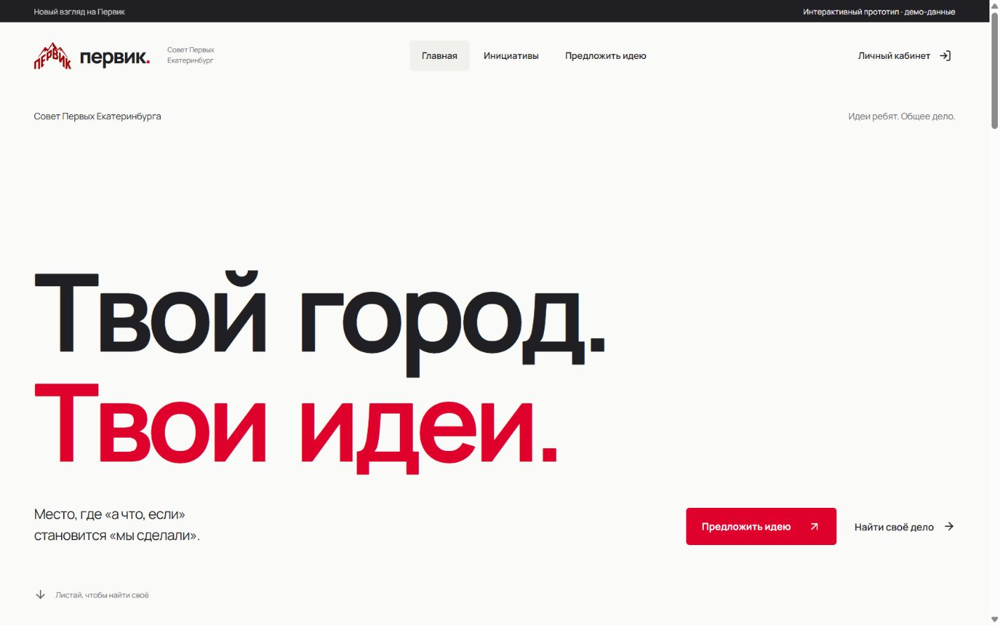

# Первик: отдельный прототип редизайна

## Запуск

Из корня репозитория после `npm ci`:

```sh
npm run design:dev
```

Открыть http://127.0.0.1:3204/.

```sh
npm run design:build
```

Создаёт самостоятельную статическую сборку в `design/prototype/dist`. Для просмотра собранной версии: `npm run design:preview`.

## Что посмотреть



[Главная на телефоне](previews/mobile.png) · [Каталог](previews/board.png) · [Кабинет](previews/cabinet.png)

- `/#home` — новая главная, крупная двухстрочная типографика и редакционные блоки.
- `/#board` — поиск, направления, лайки и порядок инициатив.
- `/#project/green` — инициатива, потребности команды, отклик и предложение реализации.
- `/#login` — выбор демонстрационной роли без сбора логина/пароля.
- `/#cabinet` — компактные заявки, база, реализации и разные разделы для ролей.
- `/#submit` — короткая заявка; после отправки она появляется в демо-кабинете.

Это интерфейсный прототип. Данные вымышлены; действия выполняются в памяти вкладки и сбрасываются после перезагрузки. Он не обращается к API платформы, не предоставляет настоящие полномочия и не заменяет авторизацию. На телефонной главной нижняя навигация появляется после прокрутки. Доступен reduced motion, клавиатурный фокус, нативные поля и модальные диалоги.

## Подключённые инструменты

Список источников и версий: `../TOOLS.lock.json`. Арт-дирекция и применение референсов: `../DESIGN.md`. Для следующих дизайн-задач читать корневой `AGENTS.md`.

- UI UX Pro Max: проектный навык `.agents/skills/ui-ux-pro-max`.
- Taste: `.agents/skills/design-taste-frontend`.
- Design Motion Principles: `.agents/skills/design-motion-principles`.
- 21st UI: `.agents/skills/21st-ui`, проектный MCP и вспомогательная команда.
- Awesome Claude Design: 57 файлов материалов в `design/references/awesome-claude-design`.
- Framer Motion: явная dev-зависимость проекта, используется только прототипом. Основной интерфейс продолжает использовать свою существующую библиотеку Motion.

Новые навыки будут доступны в следующем ходе Codex; корневые инструкции закрепляют их использование для этого проекта. Проектный MCP требует доверенного проекта и перечитывания конфигурации клиентом. В этом ходе соединение и каталог 21st проверены напрямую через официальный HTTP MCP.

## Ключ 21st

Создать локальный `.env.design-tools.local` в корне:

```dotenv
API_KEY_21ST=your_key_here
```

Файл игнорируется Git. Не использовать `VITE_`: ключ не должен попадать в браузер.

```sh
node scripts/design-tools/21st.mjs --list
node scripts/design-tools/21st.mjs get_usage
```

Для поиска сохранить JSON с полями `query`, `type`, `limit` в локальный файл, затем:

```sh
node scripts/design-tools/21st.mjs search @path/to/query.json
```

На текущей машине создан приватный `.codex/config.toml` с HTTP MCP и четырьмя инструментами чтения: поиск, референсы, код компонента и остаток квоты. Его содержимое и ключ **не отправляются в GitHub**. На другой машине использовать `.codex/config.example.toml` и свой локальный ключ.

Два бесплатных получения кода 21st использованы для изучения Motion Navigation Menu и Animated Project Cards. AI-генерация на аккаунте не включена и не вызывалась. Исходный код этих двух компонентов не включён в репозиторий; прототип использует самостоятельную реализацию изученных приёмов. Источники и авторы перечислены в DESIGN.md.

## Материалы и лицензии

Лицензии навыков сохранены рядом как `LICENSE.upstream`. Manrope распространяется по SIL OFL 1.1; текст в `assets/Manrope-OFL.txt`. Собственный логотип сохранён в SVG. Изображение участников скопировано из существующих материалов проекта и используется как иллюстрация Движения, не как фотография демонстрационного проекта.

Компьютерные и телефонные экраны просмотрены в браузере. Автоматические тесты не добавлялись и не запускались. Production-деплой не выполнялся.
